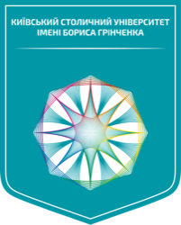

<p align="center">
  
</p>

<h1 align="center">Borys Grinchenko Kyiv Metropolitan University</h1>

<p align="center">
  <strong>🇬🇧 English</strong> ·
  <a href="https://github.com/grinchenkoedu/.github/blob/main/profile/README.uk.md">🇺🇦 Українська</a>
</p>

<p align="center">
       
</p>

<p align="center">
  <strong>Open Source Software and Educational Technology</strong>
</p>

---

## 🏛 About Us

Welcome to the official GitHub organization of **Borys Grinchenko Kyiv Metropolitan University**.
Our mission is to foster open-source development, collaborate on educational technology, and
provide tools that empower students, educators, and the broader academic community in Ukraine
and worldwide.

Our development primarily focuses on:

*   🎓 **E-Learning Enhancements:** Plugins and optimizations for Learning Management Systems like Moodle.
*   🏫 **University Information Systems:** Deans' office workflows, registries, e-portfolios and admission campaigns.
*   🔌 **API Integrations:** Seamless connections with essential services (e.g., Diia, StrikePlagiarism, Scopus, LDAP).
*   💻 **Student & Research Projects:** Collaborative academic software engineering.
*   🤖 **AI & Agentic Development:** Embracing AI-driven software engineering and agentic workflows in strict compliance with academic integrity, copyright laws, and ethical standards.

---

## 🌟 Featured Projects

*   **[antigravity-skills](https://github.com/grinchenkoedu/antigravity-skills)**, **[claude-skills](https://github.com/grinchenkoedu/claude-skills)** & **[opencode-skills](https://github.com/grinchenkoedu/opencode-skills)** — our shared toolkits of
    [Google Antigravity](https://antigravity.google/docs), [Claude Code](https://claude.com/claude-code), and [OpenCode](https://opencode.ai) skills for everyday development: planning,
    implementing, reviewing and verifying. Repository-agnostic, documented in English and
    Ukrainian. See below.
*   **[local_cleanup](https://github.com/grinchenkoedu/local_cleanup)** — a robust Moodle plugin
    designed to optimize storage and database performance by identifying and removing unnecessary
    orphaned files, old submissions, and logs.
*   **[diia-php](https://github.com/grinchenkoedu/diia-php)** — a PHP client for interacting with
    the Diia (Дія) API, facilitating digital state services integration.
*   **[strike-plagiarism-php](https://github.com/grinchenkoedu/strike-plagiarism-php)** — a PHP
    client wrapper for the StrikePlagiarism API v2, helping maintain academic integrity.

---

## 🤖 AI-Assisted Development

We develop with AI assistance openly and deliberately. Our shared toolkits live in
**[antigravity-skills](https://github.com/grinchenkoedu/antigravity-skills)**, **[claude-skills](https://github.com/grinchenkoedu/claude-skills)**, and **[opencode-skills](https://github.com/grinchenkoedu/opencode-skills)** —
[Google Antigravity](https://antigravity.google/docs), [Claude Code](https://claude.com/claude-code), and [OpenCode](https://opencode.ai) skills covering an ordinary development day.

For **Antigravity**, install them instantly via terminal:
```bash
curl -fsSL https://raw.githubusercontent.com/grinchenkoedu/antigravity-skills/main/install.sh | bash
```

For **Claude Code**, install them via the marketplace:
```
/plugin marketplace add grinchenkoedu/claude-skills
/plugin install gku@grinchenkoedu
```

For **OpenCode**, clone and run the installer:
```bash
git clone https://github.com/grinchenkoedu/opencode-skills.git && cd opencode-skills && ./install.sh
```

The toolkits share the same workflow: Claude Code and Antigravity use the `gku` prefix (with `:` vs `-` separators), while OpenCode uses `dev-` (accessed via the `/skills` picker) and adds `/dev-plan-manual` for hand-written steps:

| What it does | Claude Code | Antigravity | OpenCode |
|---|---|---|---|
| Write a repository's `CLAUDE.md`, `GEMINI.md`, or `AGENTS.md` — commands plus its family's conventions | `/gku:init` | `/gku-init` | `/dev-init` |
| Read a whole repository against the rules and hand back a plan, in branch-sized rounds | `/gku:audit` | `/gku-audit` | `/dev-audit` |
| Find an answer across the code and the internet, for the versions you actually run | `/gku:research` | `/gku-research` | `/dev-research` |
| Turn a request or a written brief into a plan, checked against the real code | `/gku:plan` | `/gku-plan` | `/dev-plan` |
| Plan work you write by hand, one walkthrough at a time | — | — | `/dev-plan-manual` |
| Build it step by step, resuming where it stopped if interrupted | `/gku:implement` | `/gku-implement` | `/dev-implement` |
| Check your own changes before you push them | `/gku:review` | `/gku-review` | `/dev-review` |
| Investigate a symptom, or apply review findings — one commit each | `/gku:fix` | `/gku-fix` | `/dev-fix` |
| Open the pull request for this branch, or update the existing one | `/gku:pr` | `/gku-pr` | `/dev-pr` |
| Review someone else's pull request in an isolated worktree | `/gku:pr-review` | `/gku-pr-review` | `/dev-pr-review` |
| Work through review comments — verdict first, never blind fixes | `/gku:pr-resolve` | `/gku-pr-resolve` | `/dev-pr-resolve` |
| Run the tests and drive the real thing to prove it works | `/gku:verify` | `/gku-verify` | `/dev-verify` |

Beyond the prefix, what differs is the harness rather than the method: each set writes the
conventions file its own tool reads — `CLAUDE.md`, `GEMINI.md`, or `AGENTS.md` — and installs the way that tool
expects.

They are repository-agnostic, run a project's commands **inside its Docker container** so checks
use the version the project actually targets, and are written to be economical enough for a basic
Claude, Google Antigravity, or OpenCode cloud/local model setup. Full documentation, including a beginner's walkthrough, is available in the respective repositories.

> **Academic integrity:** AI assistance is a tool, not an author. You remain responsible for
> every line you submit — understand it, test it, and be able to explain it. Never submit code
> you cannot account for.

---

## 🤝 How to Contribute

We welcome contributions from our students, faculty, and the global open-source community!

1. **Work on a branch** — `feature/<short-description>` or `fix/<short-description>`. Please do
   not push directly to the default branch.
2. **Read the repository's own conventions first.** Where a project has an `AGENTS.md` or
   `CLAUDE.md`, that file is the source of truth for its setup, coding style and release steps.
3. **Use Docker for local development.** Most of our projects ship a `docker-compose.yml` or a
   `Makefile`, so you should not need PHP, Composer or Python installed on your machine.
4. **Check your own work before asking for review** — `/gku:review` or `/gku-review` from our toolkits, or simply read
   your own diff carefully.
5. **Open a Pull Request and request [@matasarei](https://github.com/matasarei) as the reviewer.**
   Every change is reviewed by a person before it is merged; an automated review is a first pass,
   never the approval.
6. **Moodle plugins:** remember to bump `$plugin->version` in `version.php` when you add or move
   anything under `classes/`, or change `db/` schema, caches or scheduled tasks — otherwise a live
   site will not pick up your code.

---

## 📬 Contact & Links

*   🌐 **Website:** [kubg.edu.ua](https://kubg.edu.ua/)
*   👤 **Code review:** [@matasarei](https://github.com/matasarei)
*   📍 **Location:** Kyiv, Ukraine

---

<p align="center">
  <i>"Education is the most powerful weapon which you can use to change the world."</i>
</p>
