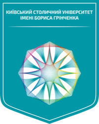

<p align="center">
  
</p>

<h1 align="center">Київський столичний університет імені Бориса Грінченка</h1>

<p align="center">
  <a href="https://github.com/grinchenkoedu">🇬🇧 English</a> ·
  <strong>🇺🇦 Українська</strong>
</p>

<p align="center">
       
</p>

<p align="center">
  <strong>Програмне забезпечення з відкритим вихідним кодом та освітні технології</strong>
</p>

---

## 🏛 Про нас

Ласкаво просимо до офіційної GitHub організації **Київського столичного університету імені
Бориса Грінченка**. Наша місія полягає у сприянні розробці програмного забезпечення з відкритим
вихідним кодом, співпраці у сфері освітніх технологій та створенні інструментів, що допомагають
студентам, викладачам та ширшій академічній спільноті в Україні та світі.

Наша розробка насамперед зосереджена на:

*   🎓 **Покращення електронного навчання:** Плагіни та оптимізації для систем управління навчанням, таких як Moodle.
*   🏫 **Інформаційні системи університету:** Робочі процеси деканатів, реєстри, е-портфоліо та вступні кампанії.
*   🔌 **API Інтеграції:** Безшовне підключення до ключових сервісів (наприклад, Дія, StrikePlagiarism, Scopus, LDAP).
*   💻 **Студентські та дослідницькі проєкти:** Спільна академічна розробка програмного забезпечення.
*   🤖 **ШІ та агентна розробка:** Впровадження підходів до розробки програмного забезпечення на базі штучного інтелекту з суворим дотриманням академічної доброчесності, авторського права та етичних стандартів.

---

## 🌟 Популярні проєкти

*   **[opencode-skills](https://github.com/grinchenkoedu/opencode-skills)**, **[antigravity-skills](https://github.com/grinchenkoedu/antigravity-skills)** & **[claude-skills](https://github.com/grinchenkoedu/claude-skills)** — наші спільні набори
    навичок [OpenCode](https://opencode.ai), [Google Antigravity](https://antigravity.google/docs) та [Claude Code](https://claude.com/claude-code) для щоденної розробки: планування,
    реалізація, рецензування та перевірка. Не прив'язані до конкретного репозиторію,
    документація англійською та українською. Див. нижче.
*   **[local_cleanup](https://github.com/grinchenkoedu/local_cleanup)** — надійний плагін Moodle,
    призначений для оптимізації продуктивності сховища та баз даних шляхом пошуку та видалення
    непотрібних файлів-сиріт, старих робіт і логів.
*   **[diia-php](https://github.com/grinchenkoedu/diia-php)** — PHP-клієнт для взаємодії з API
    Дія, що сприяє інтеграції з державними цифровими сервісами.
*   **[strike-plagiarism-php](https://github.com/grinchenkoedu/strike-plagiarism-php)** —
    обгортка PHP-клієнта для API StrikePlagiarism v2, що допомагає підтримувати академічну
    доброчесність.

---

## 🤖 Розробка за допомогою ШІ

Ми розробляємо із залученням ШІ відкрито й усвідомлено. Наші спільні набори інструментів —
**[opencode-skills](https://github.com/grinchenkoedu/opencode-skills)**, **[antigravity-skills](https://github.com/grinchenkoedu/antigravity-skills)** та **[claude-skills](https://github.com/grinchenkoedu/claude-skills)**: навички
[OpenCode](https://opencode.ai), [Google Antigravity](https://antigravity.google/docs) та [Claude Code](https://claude.com/claude-code), що покривають звичайний робочий день розробника.

Для **OpenCode**, клонуйте репозиторій і запустіть інсталятор:
```bash
git clone https://github.com/grinchenkoedu/opencode-skills.git && cd opencode-skills && ./install.sh
```

Для **Antigravity**, миттєве встановлення через термінал:
```bash
curl -fsSL https://raw.githubusercontent.com/grinchenkoedu/antigravity-skills/main/install.sh | bash
```

Для **Claude Code**, встановлення через маркетплейс:
```
/plugin marketplace add grinchenkoedu/claude-skills
/plugin install gku@grinchenkoedu
```

Набори дотримуються спільного процесу: OpenCode використовує префікс `dev-` (через меню `/skills`) і додатково має `/dev-plan-manual` для кроків, які ви пишете вручну, а Claude Code і Antigravity — `gku` (з роздільником `:` або `-`):

| Що робить | OpenCode | Claude Code | Antigravity |
|---|---|---|---|
| Створює `AGENTS.md`, `CLAUDE.md` або `GEMINI.md` репозиторію — команди та домовленості його родини | `/dev-init` | `/gku:init` | `/gku-init` |
| Читає весь репозиторій проти правил і повертає план, поділений на раунди завбільшки з гілку | `/dev-audit` | `/gku:audit` | `/gku-audit` |
| Шукає відповідь у коді та в інтернеті — для тих версій, які у вас справді працюють | `/dev-research` | `/gku:research` | `/gku-research` |
| Перетворює запит або письмовий опис на план, звірений із реальним кодом | `/dev-plan` | `/gku:plan` | `/gku-plan` |
| Планує роботу, яку ви пишете вручну, покроково | `/dev-plan-manual` | — | — |
| Виконує його крок за кроком, продовжуючи з місця зупинки після перерви | `/dev-implement` | `/gku:implement` | `/gku-implement` |
| Перевіряє ваші власні зміни перед відправкою | `/dev-review` | `/gku:review` | `/gku-review` |
| Розслідує симптом або застосовує зауваження з рецензії — по коміту на кожне | `/dev-fix` | `/gku:fix` | `/gku-fix` |
| Відкриває пул-реквест для цієї гілки, або оновлює вже існуючий | `/dev-pr` | `/gku:pr` | `/gku-pr` |
| Рецензує чужий пул-реквест в ізольованому робочому дереві | `/dev-pr-review` | `/gku:pr-review` | `/gku-pr-review` |
| Опрацьовує коментарі рецензентів — спершу вердикт, жодних сліпих виправлень | `/dev-pr-resolve` | `/gku:pr-resolve` | `/gku-pr-resolve` |
| Запускає тести й перевіряє, що воно справді працює | `/dev-verify` | `/gku:verify` | `/gku-verify` |

Окрім префікса, різниця — у середовищі, а не в методі: кожен набір пише той файл із
домовленостями, який читає його інструмент — `AGENTS.md`, `CLAUDE.md` чи `GEMINI.md`, — і ставиться так, як
той інструмент очікує.

Вони не прив'язані до конкретного репозиторію, виконують команди проєкту **всередині його
Docker-контейнера** — тож перевірки йдуть на тій версії, під яку проєкт написано, — і достатньо
ощадливі для OpenCode з хмарними або локальними моделями чи базової підписки Claude або Google Antigravity. Повна документація, разом із покроковим прикладом для
початківців, доступна у відповідних репозиторіях.

> **Академічна доброчесність:** ШІ — це інструмент, а не автор. Ви відповідаєте за кожен
> надісланий рядок: розумійте його, тестуйте й будьте здатні пояснити. Ніколи не надсилайте код,
> за який не можете відповісти.

---

## 🤝 Як долучитися

Ми вітаємо внески від наших студентів, викладачів та світової спільноти open-source!

1. **Працюйте в гілці** — `feature/<короткий-опис>` або `fix/<короткий-опис>`. Будь ласка, не
   надсилайте зміни напряму до основної гілки.
2. **Спершу прочитайте домовленості самого репозиторію.** Якщо у проєкті є `AGENTS.md` чи
   `CLAUDE.md`, саме цей файл є джерелом істини щодо налаштування, стилю коду та випуску.
3. **Використовуйте Docker для локальної розробки.** Більшість наших проєктів має
   `docker-compose.yml` або `Makefile`, тож PHP, Composer чи Python встановлювати локально не
   потрібно.
4. **Перевірте власну роботу перед тим, як просити рецензію** — командою `/gku:review` чи `/gku-review` з наших
   набору або просто уважно прочитавши власний diff.
5. **Відкрийте Pull Request і призначте рецензентом [@matasarei](https://github.com/matasarei).**
   Кожна зміна перед злиттям переглядається людиною; автоматична рецензія — це перший прохід, а не
   схвалення.
6. **Плагіни Moodle:** не забудьте підняти `$plugin->version` у `version.php`, якщо ви додали або
   перемістили щось у `classes/` чи змінили схему `db/`, кеші або заплановані завдання — інакше
   робочий сайт не побачить ваш код.

---

## 📬 Контакти та посилання

*   🌐 **Вебсайт:** [kubg.edu.ua](https://kubg.edu.ua/)
*   👤 **Код-рев'ю:** [@matasarei](https://github.com/matasarei)
*   📍 **Розташування:** Київ, Україна

---

<p align="center">
  <i>«Освіта – це найпотужніша зброя, яку ви можете використати, щоб змінити світ.»</i>
</p>
